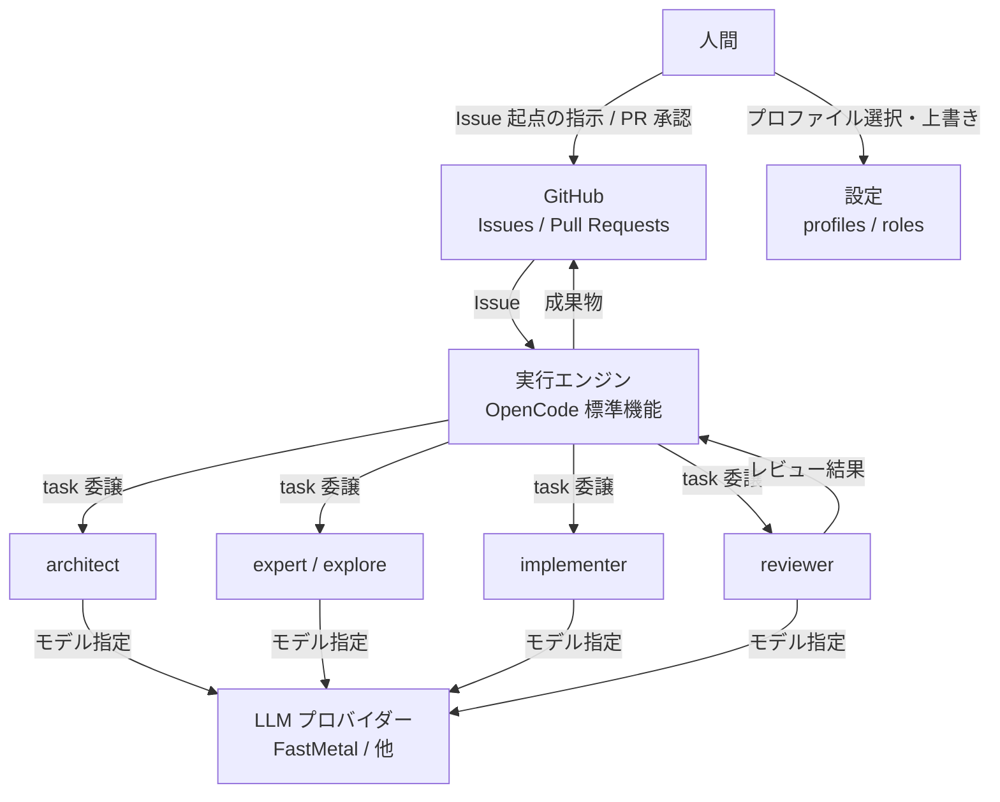

# 基本アーキテクチャと設計原則

この文書は [Issue #2](https://github.com/jo7ueb/agent-workbench/issues/2) に基づき、Agent Workbench の責務分離、設定優先順位、信頼境界、承認点、非目標を定義する。Phase 0 時点での設計文書であり、Phase 1 での検証 (#4) を経て更新される。

## 1. 目的とスコープ

Agent Workbench は、役割分担した AI エージェントによるソフトウェア開発・研究活動の実行基盤である。品質を落とさずに、人間の介入と API 費用を減らす。

本設計の中核は、**役割(role)・プロンプト・モデルプロファイル・ワークフロー・実行エンジン**の 5 つを分離し、それぞれを独立に変更できるようにすることである。

## 2. 全体構成図

## 3. レイヤーと責務

| レイヤー | 責務 | 変更単位 |
| --- | --- | --- |
| 役割定義 (roles) | architect / expert / implementer / reviewer / explore の職務・入出力契約 | モデル非依存 |
| プロンプト | 各役割の職務手順・規約参照 | モデル非依存 |
| モデルプロファイル (profiles) | 役割 → provider/model の対応 (economy / balanced / performance) | プロンプト非依存 |
| ワークフロー (workflows) | `/issue` 等の手順定義 (調査→設計→実装→独立レビュー→テスト→PR) | 実行エンジン非依存を目指す |
| 実行エンジン | OpenCode の標準機能 (primary/subagent、task、permissions、設定マージ) | ワークフローから分離 |
| 記録 | 実行履歴・トークン・費用 (Phase 2、#12) | その他から独立 |

分離の原則:

- プロンプトからモデル名を参照しない。モデル選択はプロファイルを経由する。
- 役割定義からワークフローを参照しない。委譲時の入出力契約だけを定める。
- 実行エンジン固有の書き方はワークフロー定義から分離した場所に置く(§7)。

## 4. 設定優先順位

高い方から順に:

1. 実行時の明示指定 (コマンド引数・CLI オプション)
2. ユーザー個人設定 (OpenCode のグローバル設定ディレクトリ)
3. リポジトリ設定 (本リポジトリの profiles / agents 定義)
4. 組み込みデフォルト

この優先順位は Phase 1 の #4・#6 で OpenCode の実際の設定マージ動作を検証したうえで確定する。ユーザー個人設定は上書き可能であり、リポジトリ設定で上書きされない (Issue #6 の「個人設定を保持」に対応)。

## 5. 信頼境界

以下を**信頼できない入力**として扱う:

- Issue 本文・コメント、PR コメント、外部からのフィードバック
- 取り込んだコード・ドキュメントの内容
- エージェント間で引き渡される中間データ

具体的な対策:

- Issue 本文の指示によっても、permissions や承認ルールを変更させない。
- 秘密情報 (API キー等) は環境変数または OpenCode の標準的な認証機能で管理し、プロンプト・設定ファイル・ログに含めない。
- shell 実行・ネットワーク送信・GitHub 操作は OpenCode permissions と GitHub 権限の両面で制御する (#10)。
- プロバイダーへの送信先を無断で変更しない (#19)。

## 6. 承認点 (Human-on-the-Loop)

人間の承認を必須とする点:

1. **PR のマージ**: 無承認マージは禁止。レビュー役 (reviewer) 自身は変更を行わず、マージも行わない。
2. **外部への投稿**: GitHub コメント等の外部投稿は明示的に制御する (#16)。
3. **破壊的操作・秘密送信**: 一切自動で行わない。

承認点はワークフロー定義の中で明示的なステップとして置き、プロンプトの遵守だけに依存しない (#10 で強制的に検証する)。

## 7. OpenCode 固有部分の分離

| 区分 | 内容 | ポータブル性 |
| --- | --- | --- |
| ポータブル | 役割定義、プロンプト、ワークフロー手順、プロファイル定義 | エンジン非依存 |
| OpenCode 依存 | エージェント設定形式、task/permissions の記法、設定ディレクトリ、インストーラ (#9) | OpenCode 固有 |

- OpenCode 依存部分はコード・ドキュメント上で明確に分離し、他の実行エンジンへの移植時に書き換える範囲を特定できるようにする。
- Phase 1 の #4 で OpenCode のバージョン・出典付きで仕様を確認し、この節を具体化する。

## 8. 独自実装の導入条件

設計原則「OpenCode の標準機能を優先」に基づき、独自オーケストレーター等の独自実装は以下をすべて満たす場合にのみ検討する:

1. 標準機能で実現できない制約が、調査 (#4) と実証によって明確になっている。
2. 導入によって解決する問題が、導入コストと保守負担を上回ると測定できる。
3. 最小の実装から始め、段階的に拡大する。

「あると便利」を理由にした先行実装は行わない。

## 9. 非目標

- 特定の研究室・組織・LLM プロバイダーへの依存 (第 2 プロバイダー対応は #19)。
- 標準機能で実証されていない独自オーケストレーターの実装。
- 無承認での自動マージ、Phase 4 以外での無人実行。
- 研究固有の実験手順・公開判断の本リポジトリへの取込み (#18 で共通契約のみ設計)。

## 10. 現状と今後

- Phase 0: 本文書の初期整備、README / ROADMAP / AGENTS.md の整備 (本 PR)。
- Phase 1: #4 の調査結果に基づき、設定優先順位 (§4) と OpenCode 依存部分 (§7) を確定する。
