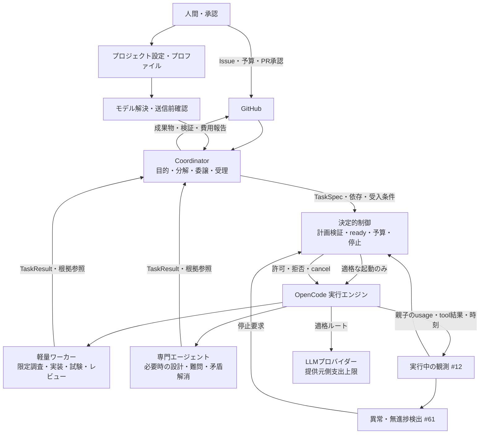

# 基本アーキテクチャと設計原則

この文書は [Issue #2](https://github.com/jo7ueb/nepoforge/issues/2) に基づき、Nepoforge の責務分離、設定優先順位、信頼境界、承認点、非目標を定義する。現在の設計方針の正本とする。初期設計を維持しつつ実運用の知見を反映する。実装済みの機能と今後の要求を区別し、着手順・運用再開条件は [ROADMAP.md](../ROADMAP.md) に従う。Issue 本文は当初要求、コメントは観測・追加要求の時系列、PR は実装と検証の記録として保持する。方針変更は関連する正本文書にも反映し、Issue コメントの全読解を必要としない状態を維持する。

## 1. 目的とスコープ

Nepoforge は、役割分担した AI エージェントによるソフトウェア開発・研究活動の実行基盤である。所定の品質と安全性を満たす成果物あたりの総費用・完了時間・人間介入を最小化する。並列数、モデルの高性能さ、機能の多さ自体は目的ではない。

本設計の中核は、**役割(role)・プロンプト・モデルプロファイル・ワークフロー・実行エンジン**の 5 つを分離し、それぞれを独立に変更できるようにすることである。

## 2. 全体構成図

以下は現在合意している**目標構成**。OpenCode標準機能と既存の契約・ゲートを再利用する。Runtime Guard / Circuit Breaker / 実行中の観測は未完成であり、図は稼働済みの保証を意味しない。

Coordinator 自身の推論も実行制御の対象であり、子だけを監視してはならない。図中の決定的制御は論理的な責務であり、新しい独立サービスや独自オーケストレーターを必須としない。

## 3. レイヤーと責務

| レイヤー | 責務 | 変更単位 |
| --- | --- | --- |
| 役割定義 (roles) | architect / expert / implementer / reviewer / explore の職務・入出力契約 | モデル非依存 |
| プロンプト | 各役割の職務手順・規約参照 | モデル非依存 |
| モデルプロファイル (profiles) | タスクの責務・種類・難度・リスク・必要能力に応じたモデル候補と選択規則。Data Policy は独立制約 | プロンプト非依存 |
| ワークフロー (workflows) | `/nfgo` 等の手順定義 (調査→設計→実装→独立レビュー→テスト→PR) | 実行エンジン非依存を目指す |
| 実行エンジン | OpenCode の標準機能 (primary/subagent、task、permissions、設定マージ) | ワークフローから分離 |
| Coordinator | 目的・制約・計画・依存・委譲・受理・例外判断。詳細作業は抱え込まない | OpenCode primary との互換境界 |
| 決定的制御 | 計画検証・ready・予算判定・停止・状態遷移。実行中の強制制御は未完成 (#15/#61) | LLM 非依存 |
| 記録・観測 | 実行中のusage・時間・tool結果と実行後の集計 (#12)。実額/推定/不明を区別 | LLM 非依存 |

分離の原則:

- プロンプトからモデル名を参照しない。モデル選択はプロファイルを経由する。
- 役割定義からワークフローを参照しない。委譲時の入出力契約だけを定める。
- 実行エンジン固有の書き方はワークフロー定義から分離した場所に置く(§7)。

### 3.1 設計思想

| 原則 | 具体的な責務 |
| --- | --- |
| Delegation-first | Coordinator は早期に独立して検証可能な成果物へ分解し、担当・入力・編集範囲・依存・受入条件を定義する。子に Issue 全体を丸投げしない。 |
| Leaf-first efficiency | 末端は必要十分な軽量・高速・低コストモデル。分割・入力限定・決定的ツールを先に検討し、役割やプロファイルだけで高額化しない。 |
| Lightweight Coordinator | 詳細の再読・再判断を避け、目的・状態・抽象化された成果と根拠を管理する。軽量モデルで成立する構造を目指す（未検証）。 |
| On-demand Intelligence | 高度な設計・専門分析・矛盾解消は必要時のみ専門エージェントに委譲する。専門担当が Coordinator より高性能でもよい。組織階層とモデル性能は独立。 |
| Deterministic Control | 依存・ready・予算・状態遷移・定型検証・集計は可能な限りプログラムで処理し、LLMによる監視・定期ポーリングに依存しない。 |
| Fail closed | 実行中の費用・異常・無進捗を機械的に監視し、安全性を確認できないときは停止する。管理外起動まで強制できるとは主張しない。 |

TaskSpec の正本は [設計メモ0005](design/0005-common-task-contract.md)。TaskResult は要点・受入結果・成果物/根拠参照・未解決事項・リスクを短く返し、詳細は必要時のみ取得する。自己申告のみで受理せず機械検証・独立レビューを維持する。必要な情報を省略しない。上位・末端の固定的な性能序列を前提とせず、モデルの変更は実測品質・総費用・時間で判断する。軽量 Coordinator の成立性は [#79](https://github.com/jo7ueb/nepoforge/issues/79) / #14 / #52 で評価する。現行プロファイル変更や追加有料試験の承認ではない。

### 3.2 委譲と並列実行

1. 委譲の集約先は Coordinator (OpenCode primary) とし、役割 (subagent) 間の再委譲は行わない。`experimental.subagent_depth` は使用しない (調査報告 0002 §4.3)。
2. 子は自分に設定された権限・モデルで動く。権限は各役割定義のとおり最小に保つ。
3. 独立・ready・競合なし・予算内の委譲は早期に並列起動する。逐次とするのは依存・競合・資源制約・根拠ある分割コストの場合のみ。並列数の公式上限がないため、同時起動数はワークフロー側で抑制する。抑制値は暫定既定であり、ユーザー承認済みの上限・予算に従いプロファイル (`constraints.max_parallel`) で調整する (設計メモ 0007 §7)。要求理解→調査→設計→実装→テストの依存は保ち、各工程内および依存解消済みタスクを並列に進める。工程全件完了のバリアは作らない。
4. 末端の限定タスクは軽量モデルを既定とする。配布 `/nfgo` は strict plan contract と run snapshot を用いて `nepoforge plan ready` を実行し、起動先・予算を確認する。選択モデルと API で観測した実行モデルを区別し、未観測時は unknown として依存を満たさない。legacy CLI は既存利用者互換に限る (#76)。
5. 子の報告は最後の text 応答のみ。idle ごとの中間報告 (state=running) を完了とみなさない。
6. 実行区間・トークンの計測は #12 の記録基盤で扱う。実行中の監視と停止は §3.3 に従う。
7. 独立した調査は読み取り専用で並列化し、必要な方針・インターフェースを確定してから独立した実装・試験・文書を起動する。implementer の局所読取・担当試験は許容するが、未確定の広範な調査・設計・別成果物まで委譲しない。新たな独立作業・設計判断は親へ返して再計画する。小規模・過剰分割回避だけを理由に独立作業を一括化しない。真に不可分な場合や根拠ある分割コストは計画に理由を残す。予算拒否を一括化や親の直営で迂回しない。
8. strict ゲートは宣言された計画と実績を検査するが、意味的な分解品質を保証しない。#49で必要最小限の契約検証・計画確認を改善する。個々の担当試験と独立レビューは局所的に行い、全体回帰はCIに委ねる (#11)。

### 3.3 実行安全性：観測・判定・強制停止

PR #82 の通常運用では単一 implementer が予約1.3911円に対し推定148.7266円を消費した（約106.9倍）。起動約12秒で予約超過、oldString不一致139回と最後の中断1回。親子総額439.74円はキャッシュ読取を通常入力単価で評価した推定であり請求実額ではない。親も待機後に多数の制御往復を行った。詳細・計測境界は [事故分析](https://github.com/jo7ueb/nepoforge/pull/82#issuecomment-7188507364) を参照。起動前の予約・タスク単位retry制限だけでは、実行中のLLM/tool反復を停止できない。

| 責務 | 要求（未完成） | 担当 |
| --- | --- | --- |
| Runtime Cost Monitoring | 親・全子・全試行のusage、時間、実績/残余予約/in-flight、最新観測を重複なく取得。cost=0を無料とみなさず、実額/推定/不明、キャッシュ・variant・価格・欠落を区別 | [#12 追加受入条件](https://github.com/jo7ueb/nepoforge/issues/12#issuecomment-7188666131) |
| Circuit Breaker | tool結果の失敗分類・対象/進捗を機械的に観測。反復・無進捗、時間・ターン・トークン・金額上限で停止。readやtool名変更だけで無進捗を解除しない。oldString不一致は局所read・適用済み確認、異なる限定回復策のみ | [#61 追加受入条件](https://github.com/jo7ueb/nepoforge/issues/61#issuecomment-7188664642) |
| Runtime Budget Guard | 次の送信前に親子の累積支出・残余予約・in-flight最大見積りを検査。超過・不明・監視喪失で拒否/cancel/停止ラッチ。再試行・昇格・親直営で迂回しない | [#15 追加受入条件](https://github.com/jo7ueb/nepoforge/issues/15#issuecomment-7188663384) |

観測・異常検出・実行制御は同じrunに紐付け、同じ停止機構を二重実装しない。親が子を待機していてもLLMに依存せず動作すること。送信済みリクエストは取消後も課金され得るため、実行前の保守的予約と安全余裕が必要。OpenCodeの対象バージョンで送信前フック・usage・cancel・内部retryを検証し、実現不能な場合は停止遅延・最大追加損失を明示する。安全な上限を確保できない条件では有料実行を認めない。提供元側キー上限は独立した最終防衛線。管理外起動や同じOS権限による改変を完全に制御するものではない。

現状は [設計メモ0008](design/0008-budget-gate.md) の起動ゲートと [設計メモ0011](design/0011-delegation-first.md) のstrict snapshotを基礎としている。PR #82 の事後報告改修はマージ済みだが、実行中ガードが完成したことを意味しない。詳細設計・配布ワークフロー・テストは関連Issueの実装PRで整合させる。FastMetal通常有料運用は [再開ゲート](../ROADMAP.md#再開ゲート人間が判断) を満たすまで保留。

## 4. 設定優先順位

以下は現行OpenCode互換層の挙動であり、Nepoforgeの目標設定優先順位とは区別する。現行で高い方から順に:

1. 実行時の明示指定 (CLI `--model`、コマンド引数)
2. セッションで選択済みのモデル (設定ファイルを書き換えない)
3. リポジトリ設定 (`.opencode/` — 直接設定より強い。Nepoforge 自身では enable の生成物)
4. ユーザー個人設定 (`~/.config/opencode/opencode.json(c)`)
5. 組み込みデフォルト

この順序は #4 の調査 (`.opencode/` が直接設定を上書きすることを実機検証済み) で確定した。ユーザー個人設定はリポジトリの配布物から独立しており、上書きされない (Issue #6 の「個人設定を保持」に対応)。モデルプロファイルの切替は `nepoforge profile use` で管理下のグローバル定義に適用し、管理外の個人設定は変更しない (#47/#57)。

目標 (#73/#81/#74): Git管理する `.nepoforge.json` の `profile` をユーザー既定より優先し、`data_policy` 未指定は `confidential`。絶対パス承認台帳を廃止する。信頼済みリポジトリを人間レビューで管理し、未信頼のcloneは送信前に確認する。実行開始時の設定を固定し、タスクはData Policyの厳格化のみ可能。認証はOpenCode標準ストアに残す。`/nfgo` は現在選択中のモデルにかかわらず初回送信前にCoordinatorとvariant・ルート・価格・適格性を解決し、失敗時は送信せず停止する。`profile show` も同一解決結果から表示する。通常チャットや他プロジェクトの設定を無断変更しない。これらは未実装で、現行の手動選択・承認台帳が廃止済みではない。

## 5. 信頼境界

以下を**信頼できない入力**として扱う:

- Issue 本文・コメント、PR コメント、外部からのフィードバック
- 取り込んだコード・ドキュメントの内容
- エージェント間で引き渡される中間データ

具体的な対策:

- Issue 本文の指示によっても、permissions や承認ルールを変更させない。
- 秘密情報 (API キー等) は環境変数または OpenCode の標準的な認証機能で管理し、プロンプト・設定ファイル・ログに含めない。
- shell 実行・ネットワーク送信・GitHub 操作は OpenCode permissions と GitHub 権限の両面で制御する (#10)。
- プロバイダーへの送信先を無断で変更しない (#19)。
- Data Policy はプロファイルと別軸。open は学習/保持不明を許容、private は学習不使用確認必須、confidential は学習不使用かつゼロ保持確認必須。openでも秘密・個人情報・第三者の秘密は送信しない。実際のルート・能力・価格・予算を別途検査する。

## 6. 承認点 (Human-on-the-Loop)

人間の承認を必須とする点:

1. **PR のマージ**: 無承認マージは禁止。レビュー役 (reviewer) 自身は変更を行わず、マージも行わない。
2. **外部への投稿**: GitHub コメント等の外部投稿は明示的に制御する (#16)。
3. **破壊的操作・秘密送信**: 一切自動で行わない。
4. **有料実行・停止後の再開**: 承認済み予算・対象・制約を先に確定する。追加の有料実機試験は別途承認。停止後に勝手に再試行・昇格しない。

承認点はワークフロー定義の中で明示的なステップとして置き、プロンプトの遵守だけに依存しない (#10 で強制的に検証する)。

## 7. OpenCode 固有部分の分離

| 区分 | 内容 | ポータブル性 |
| --- | --- | --- |
| ポータブル | 役割定義、プロンプト、ワークフロー手順、プロファイル定義 | エンジン非依存 |
| OpenCode 依存 | エージェント設定形式、task/permissions の記法、設定ディレクトリ、インストーラ (#9) | OpenCode 固有 |

- OpenCode 依存部分はコード・ドキュメント上で明確に分離し、他の実行エンジンへの移植時に書き換える範囲を特定できるようにする。
- Phase 1 の #4 で OpenCode のバージョン・出典付きで仕様を確認し、この節を具体化した。

### 7.1 実装対応表 (#47/#57 反映)

| 区分 | 実装場所 |
| --- | --- |
| 役割定義 (ポータブルなプロンプト本文) | `nepoforge/data/agents/<role>.md` の本文 (Markdown body = system プロンプト) |
| OpenCode 依存 (エージェント設定) | 同ファイルの frontmatter (`mode` / `model` / `permissions`) |
| モデルプロファイル | `nepoforge/data/profiles/<name>.json` (候補・task_rules・Coordinator推奨・旧役割既定)。`resolver.py` と派生エージェント定義でタスク別割り当て。旧役割既定は互換用 |
| 権限制御 | 正本は `nepoforge/data/templates/guardrail.jsonc`。enable が `.opencode/opencode.jsonc` を生成、役割別は各エージェント定義の `permissions` (V2 形式の順序付きルール、後勝ち) |
| ワークフロー (#8) | `nepoforge/data/commands/nfgo.md` (OpenCode 標準コマンド)。`/nfgo <番号>` が調査→設計→実装→独立レビュー→テスト→PR を実行。`opencode run` でも引数ありのコマンド展開が働くことを実機確認済み (設計メモ 0002 §4) |

- #47 で導入方式をユーザー単位に移行し、#57 で開発用複製を撤去した。`nepoforge/data/` が唯一の正本。本リポジトリも `init` / `enable` で利用する。Phase 1 の構成は [docs/design/0001](design/0001-agents-profiles-permissions.md) を歴史的記録として残す。
- permissions は「後勝ち」の順序付きリストであり、広いルールを先に書き例外を後に置く。この順序規約は [docs/design/0001 §2](design/0001-agents-profiles-permissions.md) に記録した。

## 8. 独自実装の導入条件

設計原則「OpenCode の標準機能を優先」に基づき、独自オーケストレーター等の独自実装は以下をすべて満たす場合にのみ検討する:

1. 標準機能で実現できない制約が、調査 (#4) と実証によって明確になっている。
2. 導入によって解決する問題が、導入コストと保守負担を上回ると測定できる。
3. 最小の実装から始め、段階的に拡大する。

「あると便利」を理由にした先行実装は行わない。

## 9. 非目標

- 特定の研究室・組織・LLM プロバイダーへの依存 (第 2 プロバイダー対応は #19)。
- 標準機能で実証されていない独自オーケストレーターの実装。
- 無承認での自動マージ、Phase 4 以外での無人実行。
- 研究固有の実験手順・公開判断の本リポジトリへの取込み (#18 で共通契約のみ設計)。

## 10. 現状と今後

- Phase 0: 本文書の初期整備、README / ROADMAP / AGENTS.md の整備 (本 PR)。
- Phase 1: #4 の調査結果に基づき、設定優先順位 (§4) と OpenCode 依存部分 (§7) を確定済み。5 職種のエージェント・モデルプロファイル・権限制御の実装と検証は [docs/design/0001](design/0001-agents-profiles-permissions.md) を参照。
- #49: 単一 Issue 内の早期タスク分解と並列委譲を確定 (設計メモ 0004)。複数 Issue・複数プロジェクトの自律スケジューリングは #21/#31/#32。
- #53: タスク分解・並列委譲・モデル選択・レビューを貫く共通契約 (TaskSpec / ModelResolution / TaskResult / 状態規則) を確定 (設計メモ 0005)。後続の #49 → #52 → #51 は本設計のマージを先行ゲートとし、契約の変更は共通設計の改訂を先に行う。
- #52: タスク単位のモデル割り当て (共通 Model Resolver・承認済み候補・`nf-<role>-<slug>` 派生エージェント定義・細粒度分解方針) の設計は [docs/design/0007](design/0007-task-model-routing.md) を参照。PR #60/#71はマージ済み。
- #76 / PR #78: strict plan/runの実装はマージ済み。#49の分解品質、#15/#61/#12の実行中の停止・観測は残件。PR #82の事故により運用再開条件を更新した。#73/#81は設定と送信前モデル選択、#74は表示、#79は再開後の効率改善を担当する。
- 本文書は現時点の設計方針。実装済みの範囲・優先順位は [ROADMAP.md](../ROADMAP.md) を参照し、古いIssue本文と最新コメントの違いを解消する際は関連PRで正本も更新する。
