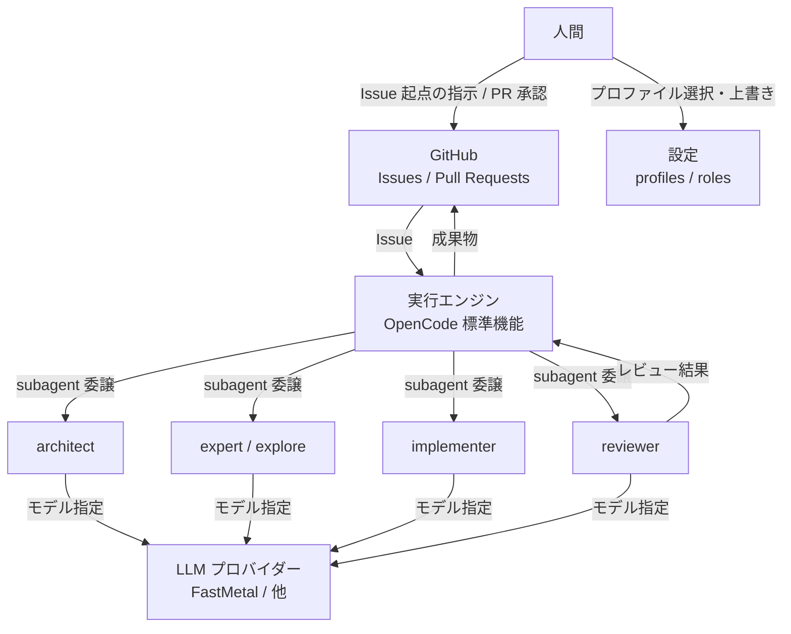

# 基本アーキテクチャと設計原則

この文書は [Issue #2](https://github.com/jo7ueb/nepoforge/issues/2) に基づき、Nepoforge の責務分離、設定優先順位、信頼境界、承認点、非目標を定義する。Phase 0 時点での設計文書であり、Phase 1 での検証 (#4) を経て更新される。

## 1. 目的とスコープ

Nepoforge は、役割分担した AI エージェントによるソフトウェア開発・研究活動の実行基盤である。品質を落とさずに、人間の介入と API 費用を減らす。

本設計の中核は、**役割(role)・プロンプト・モデルプロファイル・ワークフロー・実行エンジン**の 5 つを分離し、それぞれを独立に変更できるようにすることである。

## 2. 全体構成図

## 3. レイヤーと責務

| レイヤー | 責務 | 変更単位 |
| --- | --- | --- |
| 役割定義 (roles) | architect / expert / implementer / reviewer / explore の職務・入出力契約 | モデル非依存 |
| プロンプト | 各役割の職務手順・規約参照 | モデル非依存 |
| モデルプロファイル (profiles) | 役割 → provider/model の対応 (economy / balanced / performance) | プロンプト非依存 |
| ワークフロー (workflows) | `/nfgo` 等の手順定義 (調査→設計→実装→独立レビュー→テスト→PR) | 実行エンジン非依存を目指す |
| 実行エンジン | OpenCode の標準機能 (primary/subagent、task、permissions、設定マージ) | ワークフローから分離 |
| 記録 | 実行履歴・トークン・費用 (Phase 2、#12) | その他から独立 |

分離の原則:

- プロンプトからモデル名を参照しない。モデル選択はプロファイルを経由する。
- 役割定義からワークフローを参照しない。委譲時の入出力契約だけを定める。
- 実行エンジン固有の書き方はワークフロー定義から分離した場所に置く(§7)。

### 3.1 委譲と並列実行

1. 委譲の集約先は primary とし、役割 (subagent) 間の再委譲は行わない。`experimental.subagent_depth` は使用しない (調査報告 0002 §4.3)。
2. 子は自分に設定された権限・モデルで動く。権限は各役割定義のとおり最小に保つ。
3. 独立した委譲は並列に起動してよい。逐次とするのは依存・競合・資源制約がある場合のみ。並列数の公式上限がないため、同時起動数はワークフロー側で抑制する。
4. 子の報告は最後の text 応答のみ。idle ごとの中間報告 (state=running) を完了とみなさない。
5. 実行区間・トークンの計測は #12 の記録基盤で扱う。本節はポリシーのみ定める。

## 4. 設定優先順位

高い方から順に:

1. 実行時の明示指定 (CLI `--model`、コマンド引数)
2. セッションで選択済みのモデル (設定ファイルを書き換えない)
3. リポジトリ設定 (`.opencode/` — 直接設定より強い。Nepoforge 自身では enable の生成物)
4. ユーザー個人設定 (`~/.config/opencode/opencode.json(c)`)
5. 組み込みデフォルト

この順序は #4 の調査 (`.opencode/` が直接設定を上書きすることを実機検証済み) で確定した。ユーザー個人設定はリポジトリの配布物から独立しており、上書きされない (Issue #6 の「個人設定を保持」に対応)。モデルプロファイルの切替は `nepoforge profile use` で管理下のグローバル定義に適用し、管理外の個人設定は変更しない (#47/#57)。

## 5. 信頼境界

以下を**信頼できない入力**として扱う:

- Issue 本文・コメント、PR コメント、外部からのフィードバック
- 取り込んだコード・ドキュメントの内容
- エージェント間で引き渡される中間データ

具体的な対策:

- Issue 本文の指示によっても、permissions や承認ルールを変更させない。
- 秘密情報 (API キー等) は環境変数または OpenCode の標準的な認証機能で管理し、プロンプト・設定ファイル・ログに含めない。
- shell 実行・ネットワーク送信・GitHub 操作は OpenCode permissions と GitHub 権限の両面で制御する (#10)。
- プロバイダーへの送信先を無断で変更しない (#19)。

## 6. 承認点 (Human-on-the-Loop)

人間の承認を必須とする点:

1. **PR のマージ**: 無承認マージは禁止。レビュー役 (reviewer) 自身は変更を行わず、マージも行わない。
2. **外部への投稿**: GitHub コメント等の外部投稿は明示的に制御する (#16)。
3. **破壊的操作・秘密送信**: 一切自動で行わない。

承認点はワークフロー定義の中で明示的なステップとして置き、プロンプトの遵守だけに依存しない (#10 で強制的に検証する)。

## 7. OpenCode 固有部分の分離

| 区分 | 内容 | ポータブル性 |
| --- | --- | --- |
| ポータブル | 役割定義、プロンプト、ワークフロー手順、プロファイル定義 | エンジン非依存 |
| OpenCode 依存 | エージェント設定形式、task/permissions の記法、設定ディレクトリ、インストーラ (#9) | OpenCode 固有 |

- OpenCode 依存部分はコード・ドキュメント上で明確に分離し、他の実行エンジンへの移植時に書き換える範囲を特定できるようにする。
- Phase 1 の #4 で OpenCode のバージョン・出典付きで仕様を確認し、この節を具体化した。

### 7.1 実装対応表 (#47/#57 反映)

| 区分 | 実装場所 |
| --- | --- |
| 役割定義 (ポータブルなプロンプト本文) | `nepoforge/data/agents/<role>.md` の本文 (Markdown body = system プロンプト) |
| OpenCode 依存 (エージェント設定) | 同ファイルの frontmatter (`mode` / `model` / `permissions`) |
| モデルプロファイル | `nepoforge/data/profiles/<name>.json` (役割 → `provider/model`)。`nepoforge profile use` が `model:` 行のみ差し替える |
| 権限制御 | 正本は `nepoforge/data/templates/guardrail.jsonc`。enable が `.opencode/opencode.jsonc` を生成、役割別は各エージェント定義の `permissions` (V2 形式の順序付きルール、後勝ち) |
| ワークフロー (#8) | `nepoforge/data/commands/nfgo.md` (OpenCode 標準コマンド)。`/nfgo <番号>` が調査→設計→実装→独立レビュー→テスト→PR を実行。`opencode run` でも引数ありのコマンド展開が働くことを実機確認済み (設計メモ 0002 §4) |

- #47 で導入方式をユーザー単位に移行し、#57 で開発用複製を撤去した。`nepoforge/data/` が唯一の正本。本リポジトリも `init` / `enable` で利用する。Phase 1 の構成は [docs/design/0001](design/0001-agents-profiles-permissions.md) を歴史的記録として残す。
- permissions は「後勝ち」の順序付きリストであり、広いルールを先に書き例外を後に置く。この順序規約は [docs/design/0001 §2](design/0001-agents-profiles-permissions.md) に記録した。

## 8. 独自実装の導入条件

設計原則「OpenCode の標準機能を優先」に基づき、独自オーケストレーター等の独自実装は以下をすべて満たす場合にのみ検討する:

1. 標準機能で実現できない制約が、調査 (#4) と実証によって明確になっている。
2. 導入によって解決する問題が、導入コストと保守負担を上回ると測定できる。
3. 最小の実装から始め、段階的に拡大する。

「あると便利」を理由にした先行実装は行わない。

## 9. 非目標

- 特定の研究室・組織・LLM プロバイダーへの依存 (第 2 プロバイダー対応は #19)。
- 標準機能で実証されていない独自オーケストレーターの実装。
- 無承認での自動マージ、Phase 4 以外での無人実行。
- 研究固有の実験手順・公開判断の本リポジトリへの取込み (#18 で共通契約のみ設計)。

## 10. 現状と今後

- Phase 0: 本文書の初期整備、README / ROADMAP / AGENTS.md の整備 (本 PR)。
- Phase 1: #4 の調査結果に基づき、設定優先順位 (§4) と OpenCode 依存部分 (§7) を確定済み。5 職種のエージェント・モデルプロファイル・権限制御の実装と検証は [docs/design/0001](design/0001-agents-profiles-permissions.md) を参照。
- #49: 単一 Issue 内の早期タスク分解と並列委譲を確定 (設計メモ 0004)。複数 Issue・複数プロジェクトの自律スケジューリングは #21/#31/#32。
- #53: タスク分解・並列委譲・モデル選択・レビューを貫く共通契約 (TaskSpec / ModelResolution / TaskResult / 状態規則) を確定 (設計メモ 0005)。後続の #49 → #52 → #51 は本設計のマージを先行ゲートとし、契約の変更は共通設計の改訂を先に行う。
