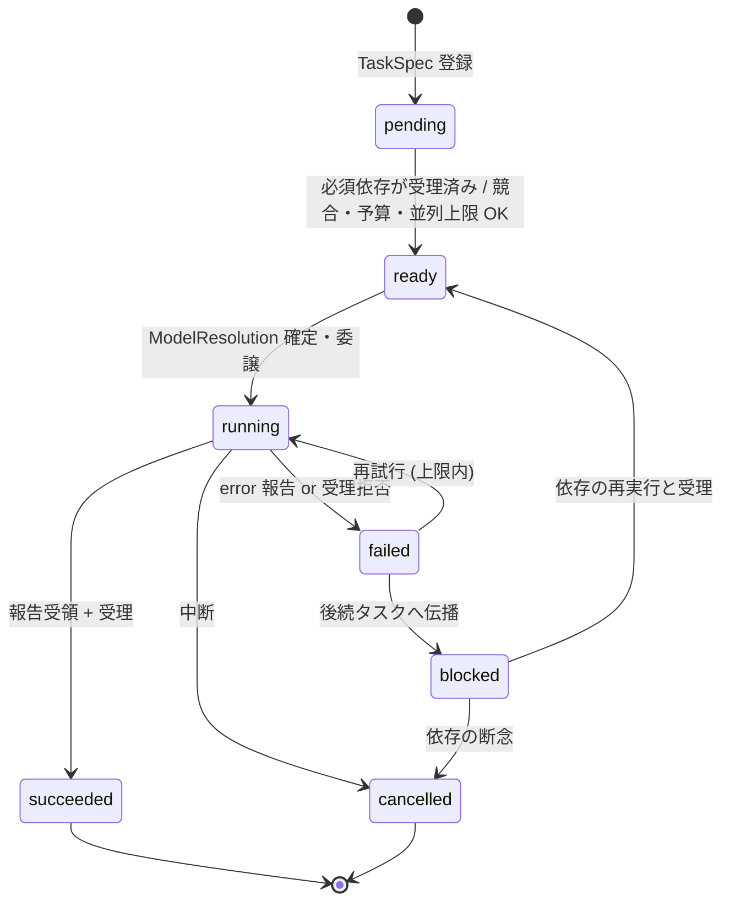

# 設計メモ 0005: タスク分解・並列委譲・モデル選択・レビューの共通契約 (#53)

状態: 起案 (設計のみ。人間のレビューと main へのマージをもって先行ゲート完了とする。実装変更は後続 Issue に限定)
関連: #53 (本設計), #49, #52, #51, #47, #4, #12, #14, #15, #16, #21
前提: [設計メモ 0004](0004-parallel-delegation.md)、[設計メモ 0003](0003-package-cli.md)、[設計メモ 0001](0001-agents-profiles-permissions.md)、[調査報告 0001](../investigate/0001-opencode-agent-delegation.md)、[調査報告 0002](../investigate/0002-parallel-delegation.md)、[architecture.md](../architecture.md)、[AGENTS.md](../../AGENTS.md)
検証環境: OpenCode **v2.4.0** (実機、2026-11-25 確認 — `opencode --version` と `opencode api get /api/info` が一致)。公式仕様の確認は 2026-11-25 時点の [tools](https://opencode.ai/docs/tools/) / [agents](https://opencode.ai/docs/agents/) / [permissions](https://opencode.ai/docs/permissions/) / [config](https://opencode.ai/docs/config/) / [models](https://opencode.ai/docs/models/) / [commands](https://opencode.ai/docs/commands/) と [config.json](https://opencode.ai/config.json)。
性質: 設計のみ。コード・新規クラス・DB・課金試験は行わない。

## 1. 目的と位置づけ

単一 Issue 内のタスク分解・並列委譲・モデル選択・レビューを貫く**共通契約 (TaskSpec / ModelResolution / TaskResult / 状態規則)** を確定し、[Issue #53](https://github.com/jo7ueb/nepoforge/issues/53) の完了条件のとおり、後続実装 (#49 → #52 → #51) の必須先行ゲートとなる設計文書として整備する。各担当が個別に設計して後から共通化する方式は採らない。契約変更が必要になった場合は共通設計を先に改訂・レビューし、個別実装が契約を分岐させない。

本設計は、並列委譲の方式を確定した [設計メモ 0004](0004-parallel-delegation.md) の**上位に契約層を重ねる**ものであり、0004 の決定 (委譲の集約先は primary、権限変更なし、委譲契約必須化) を変更しない。[architecture.md](../architecture.md) §3.1 の委譲と並列実行の規定と矛盾しない。

### 1.1 スコープ

- 対象: 単一 Issue 内のタスク分解・委譲・モデル選択・レビューの論理契約と、OpenCode v2 での実現方式。
- 対象外: Graph/Loop Engineering の全面実装、独自オーケストレーター、永続 DB、大規模モデル比較 (#14 の全面)、複数 Issue・複数プロジェクトの自律スケジューリング (#21/#31/#32)。

## 2. 現状の前提 (リポジトリ内の事実)

### 2.1 事実 (読み取り確認済み)

1. 5 役のエージェント定義 (`.opencode/agents/*.md`) は frontmatter `description` / `mode: subagent` / `model` / `permissions` の形式。編集可否は architect = `docs/**` のみ、implementer = `.opencode/**` 以外、expert / explore / reviewer = 不可 (設計メモ 0001 §2)。
2. プロファイル (`profiles/{economy,balanced,performance}.json`) は役割 → `provider/model` のマッピング (`roles`) のみを持ち、全モデルが fastmetal。
3. `scripts/switch_profile.py` と `nepoforge/profiles.py` は frontmatter の `model:` 行だけを差し替え、model 行欠如時は例外で停止する (黙って追加しない)。
4. `nepoforge/profiles.py` の `load_profile` の検証は roles マッピングの過不足とモデル表記のみであり、トップレベルの追加キーは検査対象外 (`scripts/switch_profile.py` の `load_profile` も同様)。→ プロファイルへの後方互換な拡張 (§5.4) の余地がある。
5. `tests/test_cli.py` TestDataSync: (a) agents 5 ファイルは model 行を除き `nepoforge/data/agents/` と一致、(b) `nfgo.md` は完全一致、(c) guardrail の permissions はテンプレートと一致、を検証する。
6. `.opencode/opencode.jsonc` の guardrail は shell 系の deny/ask のみで `subagent` 権限の規定がない。primary からのエージェント起動を縛るリポジトリ側の規定は現状ない (起動可否の制御は親の `subagent` 権限で可能 — §7.2 事実 5)。
7. 設計メモ 0004 により委譲契約 (目的・範囲・入出力・完了条件・依存) の必須化と報告の扱い (最後の text のみ、state=running は中間報告) が確定済み。architecture.md §3.1 もマージ済み。

### 2.2 制約

- 最小権限・Human-on-the-Loop (無承認マージ禁止)・信頼境界 (architecture.md §5) は本契約でも維持する。
- 課金試験は承認済み範囲に限る (§9)。本設計の PR は設計のみを含み、実装変更は後続 Issue に限定する。

## 3. 共通アーキテクチャ

### 3.1 パイプライン

```text
Coordinator (当面 primary)
  → Task 分解 (TaskSpec 生成・依存グラフ構築)
  → Ready 判定 (§4.4)
  → Model Resolver (§5 → ModelResolution)
  → OpenCode 委譲 (executor=agent は subagent 起動 / executor=tool は決定的実行)
  → Task Result (報告受領 → 受理判断)
  → 統合・品質ゲート (テスト → 独立レビュー → PR)
```

### 3.2 概念の分離

| 概念 | 定義 | 表現 | 変更単位 |
| --- | --- | --- | --- |
| Role | 権限・実行方法・職務 | `.opencode/agents/<role>.md` | モデル非依存 |
| Task | 一つの検証可能な目的を持つ仕事 | TaskSpec / TaskResult (§4) | 役割・モデル非依存 |
| Model | タスクを遂行する能力 | プロファイル・承認済み候補 (§5) | 役割・タスクから分離 |
| Coordinator | 分解・Ready 判定・モデル選択の起動・委譲・受理・統合に責任を持つ進行主体 | 当面 primary セッション (実行主体) | 実行エンジンから分離 |

レビュー観点は **Task の特殊化** (concern 属性) であり、別の実行基盤を作らない (#51 も同じ制約)。レビュー専用のモデルルーターも作らない (§4.5)。

### 3.3 Coordinator の進行規則

1. 実行状態の正本は Coordinator の現在のセッション。永続スケジューラー・DB を作らない (#21/#31/#32 で再検討)。
2. 単一 Issue の実行計画・状態・委譲・git/gh 操作の責任は primary が持つ。
3. architect は短い初期把握・設計判断・分割と依存関係の提案・統合設計に集中し、詳細調査は primary が並列委譲する (0004 §3 決定事項 6・§4.1 の再確認)。
4. ネスト深さは既定 1 を維持し、子からの再委譲は当面不要 (`experimental.subagent_depth` は使用しない — §7.2 事実 4)。親は結果に疑義がある場合のみ追加調査する。
5. 早期に Issue 本文・AGENTS.md・関連構造をざっと把握し、独立した問いを分ける。全部の調査完了を一律に待たず、依存が揃ったタスクから起動する。
6. 小規模変更は無理に分割しない (分解・ルーティングのオーバーヘッドが利益を上回る場合は 1 タスク)。
7. 独立調査は並列。編集は排他的に割り当てた範囲内でのみ並列。同じファイル・未確定インターフェースへの変更は逐次。
8. primary が統合・テストし、独立レビュー後のみ PR を提出する。

## 4. 共通論理インターフェース

### 4.0 原則

- 以下は言語・保存形式に依存しない論理契約。**初期表現は Markdown テンプレートと既存 JSON プロファイル**で、不要なクラス・サービス・永続 DB を作らない。
- Task は一つの検証可能な目的を持つ。TaskSpec に権限変更や自由な送信先を含めない。

### 4.1 TaskSpec

| フィールド | 必須 | 値 | 説明 |
| --- | --- | --- | --- |
| task_id | 必須 | 文字列 (計画内で一意) | Coordinator が採番。依存グラフの頂点 |
| issue_ref | 必須 | `#<番号>` | 単一 Issue 原則。複数 Issue にまたがらない |
| role | 必須 | 5 役のいずれか | 権限・実行方法は role から決まる。TaskSpec では変更しない |
| objective | 必須 | 文字列 | 一つの検証可能な目的 |
| inputs | 必須 | 参照のリスト (パス / 差分 / task_id / URL) | 根拠。全文転載しない (要点と参照先を渡す — 0004 §4.1) |
| expected_output | 必須 | 文字列 | 報告 (最後の text 応答) に含めるべき内容 |
| acceptance_criteria | 必須 | 検証可能な条件のリスト | Coordinator の受理判断の基準 |
| depends_on | 任意 | task_id のリスト | **必須依存のみ**を列挙。緩い参照は inputs に記録し ready 判定に含めない |
| read_scope | 任意 | パス / 領域のリスト | 「読むべき範囲」の宣言。権限は role のまま (昇格しない) |
| write_scope | role による | パス / glob のリスト | role ∈ {expert, explore, reviewer} では**空を強制**。architect / implementer では必須で排他的割当とする |
| capabilities | 任意 | 例: code / reasoning / search / writing | §5 のルーティング入力。#49 では記録のみ |
| complexity | 任意 | low / medium / high (既定 medium) | 同上 |
| risk | 任意 | low / medium / high (既定 medium) | 同上 |
| concern | 任意 | 文字列 (例: レビュー観点名) | Review 特殊化 (§4.5) で使用 |
| model_request | 任意 | `provider/model` (任意で `#variant`) | 許可される明示指定 (§5.1)。出所は Coordinator または人間の設定に限る |
| budget / timeout | 任意 | 承認済み制約への参照 | **未設定を無制限の許可と解釈しない**。既定上限 (ワークフロー定義に明記) を適用する。エンジン側の強制手段は `steps` (ステップ数上限) のみで、timeout の強制は未確認 (§7.3) |

検証規則 (計画時に Coordinator が確認。機械検証は後続実装で純粋関数化 — §9):

1. 権限指定・送信先指定 (permissions、エンドポイント等) を含めない。含む場合は計画エラー。
2. role ∈ {expert, explore, reviewer} で write_scope が空でない場合は計画エラー (これらの役割は権限上も編集不可 — §2.1 事実 1)。
3. depends_on の要素は既知の task_id で、循環・自己参照を許さない。起動前に検証し違反は拒否する。
4. model_request は信頼できない入力 (Issue 本文・子の報告) から決定しない。
5. budget / timeout の未設定は「既定上限の適用」であり「無制限」ではない。

### 4.2 ModelResolution

- 入力: TaskSpec + 有効なプロファイル + 承認済み候補/制約 (§5.2)。
- 出力: 次の表。

| フィールド | 内容 |
| --- | --- |
| task_id | 対象タスク |
| executor | `tool` (決定的ツール・スクリプト) または `agent` (subagent 委譲) |
| role | executor=agent の場合の委譲先役割 |
| resolved_model | executor=tool の場合は不要。executor=agent の場合は `provider/model` (任意で `#variant`) |
| 物理バインディング | resolved_model に対応するエージェント定義 ID (§7.4)。role 既定なら基本定義 `<role>` |
| 理由 | 選択根拠 (優先順位のどの段階で決まったか) |
| 制約 | 適用した制約 (候補範囲・予算・送信条件) |
| 選択状態 | selected / unresolved (停止・報告) |

決定的ツール判定: objective が標準ツール・スクリプトで決定的に達成できる (テスト実行、glob/grep 集計、lint/フォーマット等) 場合、LLM タスクにせず executor=tool とする。Coordinator が自ら遂行し、子セッションを起動しない。

### 4.3 TaskResult

| フィールド | 必須 | 内容 |
| --- | --- | --- |
| task_id | 必須 | 対象タスク |
| status | 必須 | `succeeded` / `failed` / `blocked` / `cancelled` |
| summary | 必須 | 結果の要点 |
| artifacts / evidence | 必須 | パス・差分・出典・セッション ID 等の根拠 |
| 未解決事項 | 任意 | 引き継ぐ論点 |
| acceptance_results | 必須 | acceptance_criteria ごとの判定 |
| actual_model | 必須 | 実行モデル (取得不能なら unknown と明記) |
| session_id | 任意 | 子セッション ID (機械照合用) |
| started_at / ended_at | 任意 | 取得可能な場合のみ |
| usage / cost_estimate | 任意 | 取得不能なら unknown (fastmetal の cost は常に 0 のため価格テーブルによる推定 — 0001 §3) |

受理規則:

1. Coordinator が acceptance_criteria と acceptance_results を照合し、受理 (accept) または拒否 (reject) する。**受理されるまで後続の必須依存を満たした扱いにしない。**
2. resolved_model と actual_model の不一致は報告・検証する。意図しない切替と判断した場合は失敗扱いにする。
3. 拒否時は再委譲 (再試行上限内) / 逐次実施 / 停止報告を Coordinator が判断する。
4. 秘密情報や会話本文の計測ログ保存は既定で行わない。

### 4.4 状態と実行規則



規則:

1. **ready 条件**: (a) 必須依存 (depends_on) がすべて受理済み、(b) write_scope の競合がない (同一パターンを持つタスクを同時 running にしない)、(c) 予算残がある、(d) 並列上限内 (§7.5)。
2. 失敗した必須依存は後続を blocked にするが、**無関係な作業は止めない** (0004 §4.1 報告の扱いと一致)。
3. 循環依存・不明な依存は起動前に拒否する (§4.1 検証規則 3)。
4. 再試行上限を守る (既定: 実行失敗の自動再委譲は 1 回。修正・再検証の巡数は既定 2 巡)。超過時は人間に報告する。自動無限ループを作らない。#15 の再試行・エスカレーション設計と整合させる。
5. 失効 (レビュー修正後): §4.5 のとおり、影響する観点の受理を取り消し、新しい差分に対して再検証する。

### 4.5 Review の特殊化

レビューは同じ TaskSpec / ModelResolution / TaskResult を使う Task の特殊化であり、専用の実行基盤・専用のモデルルーターを作らない。

1. TaskSpec: `role: reviewer`、`concern` 必須 (観点: Requirements / Correctness / Security 等 — カタログ本体は #51)、**対象スナップショット (コミットハッシュ / 差分の識別子) を inputs に必須**、`write_scope: 空` (検証規則 2 で強制)。
2. expected_output は構造化指摘様式: **重要度 / ファイル・行 / 根拠 / 修正提案** + 「承認」or「修正依頼」。
3. 独立性: 実装担当と別セッション・読み取り専用。モデルが同じでも実装とレビューは分離する。
4. Coordinator の統合責務: 必須観点の完了確認 (未完了・失敗した必須観点を成功と扱わない)、重複排除、矛盾解消、観点横断確認、必要な追加観点の起動。
5. 失効: 対象差分が変わった場合、影響する観点の受理を取り消し、同一 concern の新しい TaskSpec (新スナップショット) で再検証する。観点横断の判断で追加観点を起動する。
6. モデル選択は §5 の共通 Resolver を使う (観点別モデル割り当ては #51 での適用例)。

## 5. モデル選択の論理仕様 (Model Resolver)

### 5.1 選択優先順位

1. **許可される明示指定**: model_request が承認済み候補 (§5.2) に含まれ、出所が信頼できる場合に採用する。
2. **タスク別ルール**: capabilities / complexity / risk / concern → 候補の対応付け (#52 で実装。設定はプロファイル側に置く)。
3. **役割デフォルト**: 現行プロファイルの roles マッピング (既存互換デフォルト。常に存在する)。

まず §4.2 の決定的ツール判定を行い、executor=tool の場合はモデルを選ばない。

### 5.2 適格条件と承認済み候補

LLM 候補のフィルタ条件: 権限・送信先・データ保持条件 (承認済みプロバイダーのみ)、必要能力 (capabilities)、コンテキスト要件、予算。

- **承認済み候補の初期定義 (#49)**: 同梱プロファイル (economy / balanced / performance) に登場する `provider/model` の和集合 + local 上書きプロファイルの値。根拠: 各プロファイルのモデル選定は人間のレビューを経ている (設計メモ 0001 §3)。実在確認は `opencode models` 照合 (`switch_profile.py` の `verify_models_exist` と同一基準)。プロバイダーは現行 fastmetal に限定 (#19 で拡張)。
- **#52 で拡張**: 候補と制約 (データ送信・学習保持条件、コンテキスト長、予算上限) を設定として明示管理する。能力・コンテキスト長の機械可読な情報源は未確認 (§7.3) であり、初期は人間承認の選定記録 (0001 §3) で代替する。

### 5.3 候補なし時の扱い

候補が解決できない場合、ModelResolution を unresolved として**停止・報告**する。役割既定への無断フォールバック、無断の高額モデル・別プロバイダーへの切替は行わない (#52 も同じ制約)。

### 5.4 互換性

- 既存 roles マッピングは互換デフォルトとして維持し、壊さない (§2.1 事実 4)。
- モデル名はプロファイル側に置き、TaskSpec の通常の指示文・役割テンプレートに埋め込まない (architecture.md §3 分離の原則)。
- `nepoforge profile use` / `scripts/switch_profile.py` の `model:` 行差し替え方式は、基本 5 役に対しては変更しない。

## 6. 権限と安全設計

1. 権限は Role に固定し、モデル切替や TaskSpec の記述から昇格させない。派生定義 (§7.4) も権限は元の role から複製する。
2. 子は自分に設定された権限で動く (親権限のサブセットではない — §7.2 事実 5)。role の選択がそのまま権限の選択になるため、role 以外で権限を変えられる経路を作らない。
3. 起動可否は親の `subagent` 権限 (resource = エージェント ID) で制御できる。子は自分の権限で動くため、**許可されたエージェントだけを起動する**。
4. 信頼境界 (architecture.md §5): 委譲入力は primary が検証・要約した形で渡し、Issue 本文の逐語転載をしない。外部入力から model_request・権限・送信先を決定させない。
5. 無承認マージ・破壊的操作の禁止 (guardrail) は本契約でも不変。保存済み always 承認が configured deny を上書きしない仕様 (§7.2 事実 8) により、ask への連続承認で deny を突破できない。
6. budget / timeout の未設定は無制限の許可ではない (§4.1)。承認済み範囲外の課金試験・外部送信を行わない。
7. TaskResult・計測に秘密情報や会話本文を既定で保存しない。

## 7. OpenCode 適合性

### 7.1 出典

| 出典 | 用途 |
| --- | --- |
| [Tools ガイド](https://opencode.ai/docs/tools/) (Automation → Subagent) | subagent 起動の引数・バックグラウンド実行 |
| [Agents ガイド](https://opencode.ai/docs/agents/) (Formats, Options) | エージェント設定キー・model 書式 |
| [Permissions ガイド](https://opencode.ai/docs/permissions/) | 権限ルール・`subagent` 権限 |
| [Config ガイド](https://opencode.ai/docs/config/) (Experimental) / [Models ガイド](https://opencode.ai/docs/models/) (Caveats) / [Commands ガイド](https://opencode.ai/docs/commands/) | depth・リロード・コマンドの model 優先順位 |
| [config.json](https://opencode.ai/config.json) | 設定スキーマ |
| 実装 v2.4.1 | `packages/core/src/session/subagent-depth.ts` (既定 1 の確認) |
| 実機 (2026-11-25) | v2.4.0 動作確認 |
| [調査報告 0001](../investigate/0001-opencode-agent-delegation.md) / [0002](../investigate/0002-parallel-delegation.md) | 委譲の実行系事実・並列性の実測 |

### 7.2 確認済みの事実 (公式仕様 + 実機)

| # | 事実 | 出典 |
| --- | --- | --- |
| 1 | v2 の `subagent` ツールの引数はエージェント ID・`description`・完全な prompt のみ。**呼び出し単位のモデル指定はできない** | tools ガイド |
| 2 | 子のモデルは「エージェント定義の `model`、未設定なら親セッションのモデル継承」で決まる | agents ガイド (Options → Model) |
| 3 | コマンド経由のみ「コマンド model > 選択エージェント model > 親モデル」の優先順位が公式に定義されている | commands ガイド |
| 4 | `experimental.subagent_depth` は既定 1 (実装 v2.4.1 でも確認) | config ガイド (Experimental)、実装 |
| 5 | 子は親権限のサブセットではなく自分に設定された権限で動く。起動可否は親の `subagent` 権限 (resource = エージェント ID) で制御 | permissions ガイド (Agents) |
| 6 | エージェントの model 書式は `provider/model` (任意で `#variant`)。JSON では `{providerID, model, variant}` の展開形も可 | agents ガイド (Formats, Options)、config.json |
| 7 | v2 のエージェント設定キーは description / mode / model / system / permissions / steps / hidden / color / disabled / request (additionalProperties: false)。V1 の temperature / tools / permission (単数) / maxSteps 等は v2 で効果なし | agents ガイド、config.json |
| 8 | permissions は順序付き配列 `{action, resource, effect}`、後勝ち、effect は allow/ask/deny、未一致は ask。エージェント個別ルールはグローバル配列の後に追記される (置換ではない)。保存済み always 承認は configured deny を上書きしない | permissions ガイド |
| 9 | subagent は常にバックグラウンドで実行され、呼び出しは即時リターン | tools ガイド (+ 0002 P1–P3 実機) |
| 10 | 並列数上限を定める設定キー・記述は公式 docs と config.json の範囲に**不在** (不在の確認であり「上限なし」の明示宣言ではない) | tools ガイド、config.json |
| 11 | 設定は通常自動リロードされるが、実行中のモデルリクエストは開始時の設定を保持する | models ガイド (Caveats)、commands ガイド (Loading) |
| 12 | 実機: インストール済み OpenCode は v2.4.0 (`opencode --version` = `/api/info`、2026-11-25) | 実機確認 |

実行系の事実 (報告は `<background-result>` で idle ごと、親へ転送されるのは最後の text のみ、完了の同期待ち不可、message API で agent / model / tokens / cost を機械可読取得) は [調査報告 0001](../investigate/0001-opencode-agent-delegation.md)・[0002](../investigate/0002-parallel-delegation.md) の実機検証を引き継ぐ。

### 7.3 未確認事項 (断定しない)

1. `subagent` ツールの実装レベルの入力スキーマ (ドキュメント外の省略可能引数の有無)。公式仕様の範囲では起動単位のモデル指定は不可と確定したが、実装引数の全体は未確認。
2. V1 の `task` ツール引数 (非推奨。本設計は依存しない)。
3. 並列数上限の明示宣言 (上記 10 は「不在の確認」まで)。動作上の上限は実機観測に依存し、#12 の計測で把握する。
4. role×model 派生定義の生成・選択の**実機妥当性** (生成した派生定義の起動、モデル反映、並列実行。課金試験未実施 → #52 の最小実機試験で確認)。
5. [0001](../investigate/0001-opencode-agent-delegation.md) からの引き継ぎ: `ask` の非対話 (`opencode run`) 挙動、TUI でのコマンド展開と `subagent: true` コマンドの実挙動、per-agent `request` オーバーレイ (V2 ランナーが未送信 — 公式 warning。**本設計は依存しない**)。
6. timeout のエンジン側強制手段 (`steps` はステップ数のみ)。

### 7.4 実装方式の確定

起動単位のモデル指定は公式仕様として不可能 (§7.2 事実 1) であるため、モデル割当はエージェント定義 (frontmatter `model`) に固定される。そこで次の 2 段構成とする。

1. **#49 (最小実装)**: 役割既定モデルで可。5 役の既存定義 + 現行プロファイルのみで運用し、派生定義は不要。model_request が役割既定と一致しない場合は unresolved (停止/報告) 扱いとする。
2. **#52 以降 (タスク別・観点別割当)**: **承認済み role × model の汎用派生定義を共通テンプレートから生成・選択する方式を第一候補 (正規経路) とする**。生成規則:
   - 生成元は 5 役の定義 (正本は `nepoforge/data/agents/<role>.md`) で、frontmatter `model:` 行のみ差し替える (既存 `apply_to_agent` と同一機構 — §2.1 事実 3)。書式は `provider/model` (任意で `#variant`) — §7.2 事実 6。
   - **権限は同一 role から複製し変更しない** (permissions は v2 のキー — §7.2 事実 7。V1 キーを生成しない)。
   - **無制限に生成しない**: 承認済み候補 × role の組合せのみ。同一組合せからの再生成は冪等 (同一内容)。命名は `<role>-<slug>` (slug はモデル ID 由来の短縮形) とし、衝突時は生成を停止する。
   - **稼働中設定を競合更新しない**: 新規ファイルの追加のみで、既存 5 役定義 (model 行を含む) は書き換えない。設定の自動リロードは新規定義の起動に適用されるが、実行中リクエストは開始時設定を保持する (§7.2 事実 11)。生成は該当タスクの起動前に行う。
   - 配布との整合 (#47): 派生定義は**生成物**であり配布正本 (`nepoforge/data/`) には含めない。TestDataSync は 5 役のみを比較するため影響しない (§2.1 事実 5)。生成を CLI に組み込むか (例: `nepoforge profile use --derive`) は #52 で判断する。
3. **コマンド経由の model 指定について**: 優先順位自体は公式に定義されている (§7.2 事実 3) が、コマンド展開は composer/TUI 層の機能であり、`opencode run` では展開されないことが実機確認済み (0001 T5)。稼働中の primary からの委譲ループでは利用できないため、本契約の実現経路には採用しない。
4. **並列起動が不可能になった場合** (将来の仕様変更等): 根拠を報告し、独自実行基盤の採用は別の人間判断とする (architecture.md §8 の導入条件)。

### 7.5 並列性と同時実行数

- 1 ターンからの複数 subagent 並列起動と時間的重複は実機確認済み (0002 P1: 重複 531 ms、P3: 重複 92.975 秒)。
- 並列数の公式上限は不在 (§7.2 事実 10) であり、同時起動数の抑制は Coordinator 側のポリシー (§4.4 ready 条件 d) で持つ。既定の上限値 (例: 同時 running 3) の確定値は #49 の実装 PR で実測に基づき提示する。

## 8. 影響範囲 (提案)

本設計自体は `docs/design/0005-common-task-contract.md` の追加のみ。以下は後続 Issue での変更提案であり、本 PR では実施しない。

| 種別 | 対象 | 内容 | 時期 |
| --- | --- | --- | --- |
| 変更する (提案) | `.opencode/commands/nfgo.md` + `nepoforge/data/commands/nfgo.md` | 委譲契約を TaskSpec / TaskResult 様式へ拡張。Ready 判定・受理・失効の規定を追加 (完全一致同期を維持 — §2.1 事実 5) | #49 |
| 変更する (提案) | `AGENTS.md` | 「委譲と並列実行」節に TaskSpec / TaskResult の必須項目化を追記 | #49 |
| 変更する (提案) | `docs/architecture.md` / `ROADMAP.md` | 本設計へのリンク・現状追記 (§3.1 の委譲規定と競合しない) | 本 PR / #49 |
| 変更する (提案) | `profiles/*.json` + `nepoforge/data/profiles/` | roles マッピング維持のまま optional キー追加 (候補・タスク別ルール — §5.4) | #52 |
| 変更する (提案) | `nepoforge/` (CLI・Resolver) / `tests/` | Model Resolver・派生定義生成・契約検証の実装 | #49 / #52 |
| 変更しない | 5 役の permissions、`.opencode/opencode.jsonc`、`experimental.*` | 最小権限・guardrail・実験的設定は触れない | — |
| 調整 | #47 の配布手順 | 新たな同梱物 (テンプレート等) を追加する場合の data 配置・同期設計 | #49 / #52 |

## 9. テスト・検証計画 (テスト境界の確定)

1. **課金なし単体テスト** (`python3 -m unittest discover -s tests -t .`):
   - 契約検証関数 (後続実装): 依存循環・不明依存・status 列挙・write_scope 空 (expert/explore/reviewer)・model_request 表記 (`provider/model`) の検証。
   - プロファイル互換: roles は 5 役すべて必須・表記検証・トップレベル追加キーの許容・local 上書き (§5.4)。
   - 派生定義生成 (#52 実装時): 権限同一性・model 行差し替え・冪等性・命名衝突時の停止。
   - TestDataSync は変更不要の見込み (派生定義は比較対象外 — §7.4)。
2. **最小実機試験 (承認済み範囲・最小課金)**:
   - (1) 役割既定での委譲 → message API で actual_model を機械照合 (0001 T2 手法)。
   - (2) 並列起動の時間的重複 (0002 §3 の session DB / API 手法)。
   - (3) 派生定義の起動・モデル反映・並列実行 (#52 実装時。課金試験の承認後に実施 — §7.3 未確認 4)。
   - 証拠 (セッション ID・busy 区間) を PR 本文に記録する。
3. **E2E (課金あり、PR レビュー後にユーザーが実施)**: `/nfgo` 全体で TaskSpec 受理・失効・再検証・独立レビューの運用確認 (0003 §9 / 0004 §6 と同じ扱い)。

## 10. 適用例 (TaskSpec / ModelResolution / TaskResult)

初期表現 (Markdown テンプレート) の例。実例は #49 の実装で nfgo.md の委譲契約に反映する。

### 10.1 調査タスク (expert)

```markdown
### TaskSpec
- task_id: T1
- issue_ref: "#53"
- role: expert
- objective: OpenCode v2.x の subagent 委譲におけるモデル指定の公式仕様を確認する
- inputs:
  - docs/investigate/0001-opencode-agent-delegation.md (先行調査。要点のみ)
  - https://opencode.ai/docs/tools/ (Automation → Subagent)
  - https://opencode.ai/docs/agents/ (Options → Model)
- expected_output: 事実/未確認の区別付き報告。主張ごとに出典 URL と取得日
- acceptance_criteria:
  - 起動単位のモデル指定の可否が出典付きで述べられている
  - 確認できない点が「未確認」と明記されている
- depends_on: (なし)
- read_scope: docs/investigate/**、公式ドキュメント (web)
- write_scope: (空 — expert は読み取り専用)
- capabilities: search, reasoning
- complexity: medium
- risk: low
- model_request: (なし)
- budget/timeout: 既定上限 (ワークフロー定義) に従う
```

```markdown
### ModelResolution (T1)
- executor: agent
- role: expert
- resolved_model: fastmetal/japan-glm-5.3-flash
- 物理バインディング: 基本定義 `expert`
- 理由: model_request なし → 役割デフォルト (現行プロファイル balanced)
- 制約: 承認済み候補内・fastmetal 限定
- 選択状態: selected
```

明示指定の変形: `model_request: fastmetal/japan-deepseek-v4.1-flash-1017` の場合、同モデルは承認済み候補 (performance プロファイルに登場) に含まれるため、優先順位 1 (許可される明示指定) で resolved となる。ただし役割既定と異なるため物理バインディングは派生定義 `expert-<slug>` となり、生成は #52 の実装に依存する (**#49 では unresolved (停止/報告)**)。候補外のモデルが指定された場合は無条件に unresolved とする。

```markdown
### TaskResult
- task_id: T1
- status: succeeded
- summary: 起動単位のモデル指定は不可。子のモデルはエージェント定義の model (未設定なら親継承)
- artifacts/evidence:
  - 出典: https://opencode.ai/docs/tools/ (Automation → Subagent)、https://opencode.ai/docs/agents/ (Options → Model) — 2026-11-25 取得
  - session_id: ses_...
- 未解決事項: subagent ツールの実装レベル入力スキーマの全体
- acceptance_results:
  - [x] 起動単位の可否を出典付きで記載した
  - [x] 未確認事項を明記した
- actual_model: fastmetal/japan-glm-5.3-flash
- session_id: ses_...
- started_at/ended_at: 2026-11-25 10:12 / 10:14
- usage/cost_estimate: tokens=約4.2k / cost=unknown (fastmetal の cost は 0 のため価格テーブルで推定)
```

### 10.2 実装タスク (implementer)

```markdown
### TaskSpec
- task_id: T3
- issue_ref: "#53"
- role: implementer
- objective: 共通契約の依存グラフ検証 (循環依存・不明依存の検出) を実装し、単体テストを通す
- inputs:
  - docs/design/0005-common-task-contract.md §4.1 (検証規則)
  - 対象: nepoforge/planning.py、tests/test_planning.py (排他的割当)
- expected_output: 実装差分の要約、テスト実行コマンドと結果、スコープ外変更の有無
- acceptance_criteria:
  - `python3 -m unittest discover -s tests -t .` が課金なしで通る
  - 循環依存・不明依存が起動 (実行) 前に拒否される
  - スコープ外の変更がない
- depends_on: T1 (設計受理済み), T2 (現状把握受理済み)
- read_scope: nepoforge/**、tests/**、docs/design/0005-*
- write_scope: nepoforge/planning.py、tests/test_planning.py
- capabilities: code
- complexity: medium
- risk: medium
- model_request: (なし)
```

```markdown
### TaskResult
- task_id: T3
- status: succeeded
- summary: 依存循環検出を nepoforge/planning.py に追加。単体テスト 12 件が成功
- artifacts/evidence:
  - 差分: nepoforge/planning.py (+48 行)、tests/test_planning.py (+60 行)
  - テスト: `python3 -m unittest discover -s tests -t .` → OK (12 tests)
- 未解決事項: (なし)
- acceptance_results:
  - [x] テストが課金なしで通った
  - [x] 循環・不明依存が拒否される
  - [x] スコープ外変更なし
- actual_model: fastmetal/beam-1.0
- session_id: ses_...
- usage/cost_estimate: unknown
```

Coordinator がテスト出力を確認して T3 を受理 → T5 (レビュー) が ready になる。write_scope が重複するタスク (同じファイルへの別 implementer タスク) は T3 の running 中には ready にならない。

### 10.3 レビュータスク (reviewer — Review の特殊化)

```markdown
### TaskSpec
- task_id: T5
- issue_ref: "#53"
- role: reviewer
- concern: Correctness
- objective: スナップショット commit <hash> の差分を正確性・境界条件・異常系の観点でレビューする
- inputs:
  - 対象スナップショット: commit <hash> (差分識別子)
  - docs/design/0005-common-task-contract.md §4.1 (契約)
- expected_output: 構造化指摘 (重要度 / ファイル・行 / 根拠 / 修正提案) + 「承認」or「修正依頼」
- acceptance_criteria:
  - 指摘に根拠となるファイル・行が付く
  - 観点 (Correctness) 外の指摘は付記として分離されている
- depends_on: T3 (受理済み)
- read_scope: 対象差分と周辺コード
- write_scope: (空 — reviewer は読み取り専用)
- capabilities: reasoning
- complexity: medium
- risk: medium
- model_request: (なし)
```

```markdown
### TaskResult
- task_id: T5
- status: succeeded
- summary: 修正依頼 1 件・承認見込み (指摘対応後)
- artifacts/evidence:
  - 対象スナップショット: commit <hash> の差分 (指摘の根拠行は各指摘に記載)
- findings:
  - 重要度: major | ファイル・行: nepoforge/planning.py L42–48 | 根拠: 自己参照の依存が未検出 | 修正提案: task_id 自身を depends_on に含む場合の早期拒否を追加
  - 重要度: minor | ファイル・行: tests/test_planning.py L30 | 根拠: 異常系のテスト名が実体と不一致 | 修正提案: テスト名の修正
- 未解決事項: (なし)
- acceptance_results:
  - [x] 指摘に根拠行が付いている
  - [x] 観点外の指摘を分離した
- actual_model: fastmetal/glm-5.3
- session_id: ses_...
- usage/cost_estimate: unknown
```

Coordinator の統合: Security 観点の T6 との重複指摘 1 件を排除し、T5/T6 間の矛盾 (依存検証の責務位置) を解消して両者を受理。実装修正後は新スナップショットに対して影響する観点 (T5/T6) を再検証し、再検証の巡数上限 (既定 2) を守る。

## 検証結果

本 PR は設計のみであり、課金試験・実装変更は行っていない。確認した内容:

1. **公式仕様確認 (expert 調査 + 実機確認、2026-11-25)**: §7.2 の 12 項目。特に、起動単位のモデル指定の不可 (事実 1)、並列数上限の不在確認 (事実 10)、設定リロードと実行中リクエストの挙動 (事実 11) を本設計の前提として確定した。
2. **実機バージョン確認**: v2.4.0 (`opencode --version` と `opencode api get /api/info` が一致)。公式仕様調査は v2 系 (v2.4.x) の文書に基づく。
3. **リポジトリ内の事実確認**: §2.1 (エージェント定義・プロファイル・適用スクリプト・同期テスト・guardrail の読み取り)。
4. **実施していない検証**: 派生定義の実機妥当性 (§7.3 未確認 4)、並列数の実動作上限の観測 (#12 に委ねる)。これらは後続 Issue の最小実機試験 (§9) で確認する。

## 制約・残存リスク

1. **報告は最後の text のみ**: TaskResult は text 慣約ベースであり、子が様式を外すと受理判断の材料が欠ける。機械可読な構造化・突合は #12 の記録基盤まで暫定 (委譲契約の expected_output で様式を強制して軽減)。
2. **状態の正本がセッション**: セッション喪失時に計画・受理状態を失う。PR 本文・進行メモへの要約で軽減する (永続化はしない)。
3. **並列数の公式上限不在**: 抑制はポリシーでありエンジン強制ではない。同時起動数の観測は #12。
4. **`ask` の非対話挙動** (0001 残存課題): 無人実行で shell `ask` を持つ implementer に影響する可能性。
5. **fastmetal の cost は常に 0**: cost_estimate は価格テーブル (0001 §3) による推定であり、実費との照合は #12/#14。
6. **timeout のエンジン側強制手段なし** (`steps` はステップ数のみ): Coordinator の進行監視 (報告の到達監視) で代替する。
7. **派生定義の実機妥当性は未検証** (課金試験未実施): #52 の実装時に最小試験で確認するまで、派生定義に依存する機能 (#52/#51) を本番運用に使用しない。
8. **deny はツール不可視化**で理由が残りにくい (0001 T3): 権限違反の監査は #12 で補完する。

## 代替案と不採用理由

| 案 | 不採用理由 |
| --- | --- |
| subagent 呼び出し時のモデル上書き引数 | 公式仕様に存在しない (§7.2 事実 1)。未確認の API を仮定しない |
| 委譲直前に 5 役定義の `model:` 行を差し替えて使い分け | 同一 role の並列タスクで競合し、稼働中設定の競合更新に当たる (実行中リクエストは開始時設定を保持 — 事実 11)。冪等でない |
| プロファイル切替 (`profile use`) による起動直前の使い分け | 全役割に波及し競合更新に当たる。基本 5 役の model 行の書き換えは差分管理も崩す |
| コマンド経由での起動単位モデル指定 | 優先順位は公式定義だが、コマンド展開は composer/TUI 層の機能で `opencode run` では展開されない (0001 T5)。稼働中の委譲ループから使えない |
| レビュー専用の実行基盤・観点別モデルルーター | Review は Task の特殊化で統合 (Issue #53/#51 の決定)。基盤の二重化を避ける |
| TaskSpec に権限・送信先を含める | 権限固定 (§6)・信頼境界に反する昇格経路になる |
| モデル名を TaskSpec の通常記述や役割テンプレートに埋め込む | 分離原則 (architecture.md §3) に反する。モデルはプロファイル・承認済み候補側に置く |
| 候補なし時の無断フォールバック (役割既定・高額モデルへ) | 無断の高額化・別プロバイダー切替を禁止 (#52)。停止/報告を正とする (§5.3) |
| 永続スケジューラー・DB による状態管理 | Issue #53 が排除。正本は Coordinator セッション (§3.3)。#21/#31/#32 で再検討 |
| 子からの再委譲 (`experimental.subagent_depth` 引き上げ) | experimental 依存・権限拡大 (0004 §7 と同じ理由)。当面不要 (§3.3 規則 4) |
| 契約を JSON スキーマ + 検証コードとして本設計内で実装 | 本 Issue は設計のみ。実装・表現の確定は #49/#52。初期表現は Markdown / 既存 JSON で十分 |
| 派生定義の無制限生成 (任意モデルを都度生成) | 承認済み候補に限定しないと権限・費用・送信条件の管理が不能。エージェント定義の増殖を防ぐ (§7.4) |

## 後続 Issue との対応

| Issue | 責務 | 依存 | 変更対象 (想定) | 受入試験 (本設計との対応) |
| --- | --- | --- | --- | --- |
| [#49](https://github.com/jo7ueb/nepoforge/issues/49) | 共通 TaskSpec・委譲・状態/Result の**最小実装** (役割既定モデルで可) | 本設計 (#53) のマージ | `.opencode/commands/nfgo.md` (+ data 同期)、`AGENTS.md` 追記、必要なら `docs/architecture.md` | 課金なし単体: 契約検証 (§9.1)。最小実機: 並列起動の重複・actual_model 照合 (§9.2 (1)(2)) |
| [#52](https://github.com/jo7ueb/nepoforge/issues/52) | 共通 Model Resolver・承認済み候補・プロファイル互換・実行モデル観測 | #49 の基盤 + 本設計 §5/§7.4 | `profiles/*.json` の optional 拡張、`nepoforge/` (Resolver・派生定義生成)、配布手順 | 候補外拒否・選択不能時の停止報告 (§5.3)、派生定義の実機試験 (§9.2 (3))、actual_model 突合 (§4.3)、役割固定との比較 |
| [#51](https://github.com/jo7ueb/nepoforge/issues/51) | レビュー観点の体系化・並列レビュー・観点別モデル割り当て | #49 + #52 | `/nfgo` のレビュー工程、観点カタログ (docs/) | 並列レビューの時間的重複ログ、2 種以上モデルの実行確認、修正後の失効・再検証 (§4.5)、統合処理 (§4.5 規則 4) |

- #49/#52 は後続 (#51/#16) を見据えた境界を保つ。契約の変更は共通設計 (本書) の改訂・レビューが先。
- #12/#14/#15 (計測・評価・予算・再試行) は本契約の観測・上限の基盤として参照するが、本設計はその全面実装を要求しない。
- #47 の配布形式に依存しない論理契約とする (配布物追加は §8 の調整対象)。

## 11. 本 PR で反映する文書参照

本設計 PR では、Issue #53 の完了条件「architecture.md / ROADMAP からリンクする」を最小差分で満たすため、次の 2 点だけを本 PR に含める (実装・契約の変更ではない)。

- `docs/architecture.md` §10 の現状欄に本設計へのリンクを 1 項目追加する。
- `ROADMAP.md` に Phase 2 の前提として本設計へのリンクを 1 行追加する。

`.opencode/`・`nepoforge/`・`AGENTS.md` への変更は行わない (いずれも §8 の提案に留める)。

## 人間の判断が必要な事項

1. **本設計の承認・マージ** (後続 #49/#52/#51 の先行ゲート)。
2. **承認済み候補の初期定義** (§5.2: 同梱プロファイルの和集合 + local 上書き) の承認。現行プロファイル限定にするより広い候補を許す判断を含む。
3. **派生定義方式の採用** (§7.4) と、その実機妥当性試験 (最小課金) の実施許可。命名・生成 CLI・管理方針は #52 の実装 PR で提示する。
4. **既定上限の承認**: budget / timeout / 再試行 (既定 1 回) / 再検証巡数 (既定 2) / 同時 running 数 (例: 3)。具体値は #49 の実装 PR で提示する。
5. **レビュー統合担当の位置づけ** (primary のままか独立のレビュー統括役を設けるか) — #51 での判断 (Issue #51 も「Primary または独立したレビュー統括役」としている)。
6. **並列起動が実機で不可能になった場合の独自実行基盤採用の是非** (§7.4 規則 4、architecture.md §8)。
