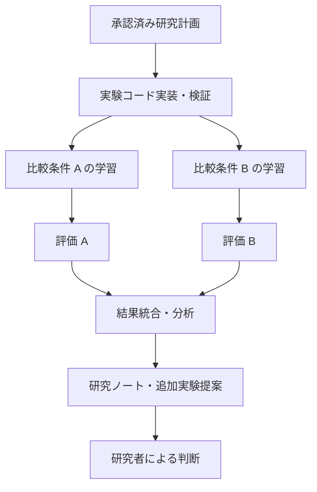

# Autonomous R&D Factory — 長期技術構想

記録日: 2026-11-24  
状態: Deferred（将来構想。着手未承認）

## 目的と位置づけ

Agent Workbench を、人間の監督下で研究・開発・教育・校務を継続的に進める自律型研究開発工場へ発展させる。人間は目的・制約・資源配分・最終判断を担い、AI は承認範囲内で調査・設計・実行・検証・記録を担う。就寝中にも承認済みの仕事が進み、翌朝に成果・費用・阻害要因を確認できる状態を目指す。

本書は [#37](https://github.com/jo7ueb/agent-workbench/issues/37) の長期ビジョンを技術面から補完する。リポジトリを設計知識の正本とし、Issue は実行依頼として扱う。現在の MVP や既存の優先順位を変更しない。本書自体は実装指示でも実行承認でもない。

## 設計領域

以下は本プロジェクトでの作業上の定義であり、一般に統一された分類や厳密な階層を主張するものではない。

| 領域 | 責務 |
| --- | --- |
| Prompt Engineering | 個々の指示と出力契約 |
| Context Engineering | 仕様・知識・記憶・実行状態の供給 |
| Harness Engineering | ツール、権限、実行環境、検証、役割分担 |
| Loop Engineering | 評価・修正・再試行・停止の閉ループ制御 |
| Graph Engineering | タスクの依存関係、並列化、分岐、合流、実行状態 |

OpenCode を当面のハーネスとし、モデルやプロバイダーから独立した設計を維持する。独自オーケストレーターの導入は必要性を実証してから判断する。

## Loop Engineering

個別作業の実行・検証・修正ループと、承認済み作業集合から次の仕事を選ぶ外側のループを区別する。

- 完了条件はテスト・独立レビュー・成果物の検証などで明示する。AI の自己申告だけで合格としない。
- 再試行回数、時間、費用、並列数、進捗停滞を停止条件にする。予算は並列実行全体でも管理する。
- 失敗時は原因分類、再試行、上位モデルへの委譲、人間へのエスカレーションを選択する。承認範囲を超えない。
- 実行状態・成果・費用・判断根拠を永続化し、中断・再開・キャンセル・重複防止を可能にする。
- 通常の /npgo の承認契約を維持し、継続実行は明示的に選択する。無承認マージは禁止する。

関連: #12、#15、#28、#31。

## Graph Engineering

仕事を型付きノードと依存関係で表現し、実行可能なノードだけをスケジュールする。ノードは LLM に限らず、スクリプト、CI、Slurm ジョブ、人間の承認などを含む。

- 入出力、成果物、前提条件、権限、資源要求、完了条件を定義する。
- 依存関係、条件分岐、並列実行、合流、失敗伝播、承認待ちを明示する。
- 作業ディレクトリやブランチを分離し、競合・重複実行を防止する。
- 依存グラフは原則 DAG とし、反復は境界と停止条件を持つループとして表現する。実行時のグラフ拡張は承認済み範囲に限定する。
- 決定的に処理できる制御を LLM に丸投げしない。

研究ワークフロー例（実装仕様ではない）:

実験条件・seed・コードの版・生データ・図・実行ログを追跡可能にし、結果と仮説を区別する。公開可否や研究上の結論は人間が判断する。

関連: #18、#20、#21、#31。

## Self-Improving Factory

工場自体の実行履歴から失敗パターン、品質、費用、所要時間、人間介入を分析し、プロンプト・ハーネス・ループ・グラフの改善を提案する。改善は独立した検証と PR を経て人間が承認する。AI が自ら権限・予算・品質基準を緩和することは認めない。

評価指標候補: 合格成果物あたりの費用、成功率、再試行率、経過時間、人間介入時間、再現性、障害復旧率。固定課題で比較し、モデル変更と基盤変更の効果を区別する。

## 発展順序（既存 Phase を置き換えない）

1. Harness: 現在の MVP を実運用で検証する。
2. Loop: 承認済み範囲内で継続実行し、安全停止・復旧・費用制御を実証する。
3. Graph: 複数作業の依存関係と並列実行を明示的に制御する。
4. Self-improvement: 実測に基づく基盤改善を継続する。

着手は人間が改めて決定する。具体的なフレームワーク、永続化方式、コマンド仕様、実装時期は未決定。既存の [ROADMAP](../../ROADMAP.md) と関連 Issue を再確認し、重複起票を避ける。

## 外部管理基盤との境界

仕事全体の優先順位・期限・進捗は外部の仕事管理基盤（運用例: Neport）に委ねる。GitHub は知識・成果の正本と実行依頼・レビューの場とする。Agent Workbench は特定の管理基盤への依存を必須としない。

## 将来の研究課題候補

モデルとハーネスの寄与の分離、異種モデルへの最適な仕事配分、資源制約下の実行制御、非決定的エージェントの品質保証、自律研究の再現性とトレーサビリティ。工場の日常運用を実証フィールドとして活用する可能性を検討する。研究テーマとしての採択や実施は別途判断する。
