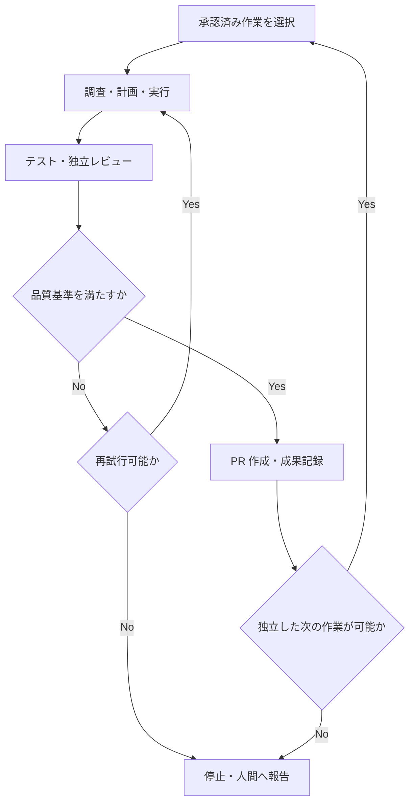
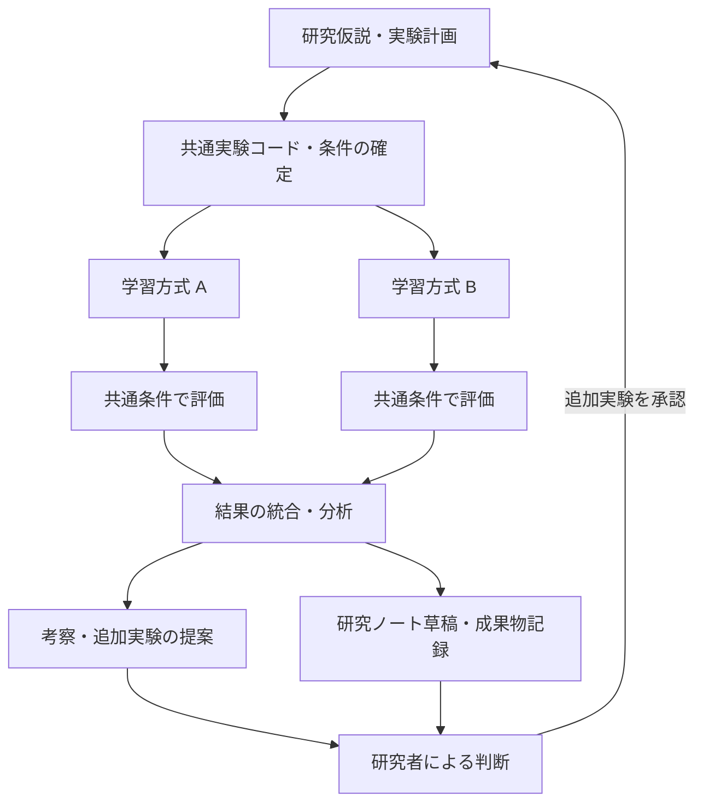

# 将来構想 — Loop Engineering / Graph Engineering / Self-Improving Factory

- 記録日: 2026-11-24
- 状態: Deferred / 長期構想（未着手、実装承認ではない）
- 関連: [長期ビジョン #37](https://github.com/jo7ueb/nepoforge/issues/37)、[ロードマップ](../ROADMAP.md)、[基本アーキテクチャ](architecture.md)

## 1. 目的と位置づけ

Nepoforge の長期目標は、人間の監督の下で複数の研究開発活動が継続する Autonomous R&D Factory である。人間が目的・方向性・制約・資源配分・最終承認を担い、エージェントが調査・設計・実装・実験・検証・記録を進める。人間の稼働時間と研究開発の稼働時間を切り離し、睡眠中や他の仕事中にも承認済みの仕事が進む状態を目指す。研究・ソフトウェア開発に加え、教育準備・校務などの知的作業への応用も視野に入れる。

本書は 2026-11-24 の議論で生まれた将来の設計構想を保存する正本であり、実装仕様・実行指示・着手済みタスクではない。短期の目標は最低限の /nfgo による実運用であり、本書のために MVP を遅らせない。#37 が扱う全体ビジョンと Phase 0〜5 のロードマップを補完する。具体的な機能・期日・予算・採用技術は将来、人間が判断してから Issue 化する。

## 2. 五つの設計観点

ここでの用語は設計上の作業定義であり、普遍的に標準化された分類や厳密な包含関係を主張するものではない。各観点は重なり、相互に補完する。

| 観点 | 設計対象 | Nepoforge での対応 |
| --- | --- | --- |
| Prompt Engineering | 個々の指示・役割・出力形式 | 役割別プロンプト |
| Context Engineering | 適切な知識・仕様・履歴・状態を供給する方法 | AGENTS.md、リポジトリ、外部知識基盤 |
| Harness Engineering | エージェントが安全かつ有効に働く環境 | OpenCode、ツール、権限、モデルプロファイル、CI、独立レビュー |
| Loop Engineering | フィードバックによる反復、停止、復旧 | /nfgo の継続実行、品質判定、再試行、予算制御 |
| Graph Engineering | ワークフローの依存関係・分岐・並列・合流 | 実行グラフとスケジューリング |

ハーネスは個々の作業者を成立させ、ループは継続稼働を、グラフは複数の作業者や非 AI 処理の協調を担う。工場全体はこれらに人間の監督と既存の仕事管理・知識管理・成果物管理を組み合わせたものである。既存の管理基盤を置き換えない。

## 3. Loop Engineering — 反復実行を設計する

単に LLM に「完了まで繰り返せ」と指示するのではなく、実行状態、評価方法、遷移条件、停止・復旧を明示する。少なくとも次の二つのループを区別する。

- 作業内ループ: 調査・計画 → 実装 → テスト・独立レビュー → 修正 → 再検証。
- 作業間ループ: 承認済みの実行可能な Issue を取得 → 作業内ループ → PR・記録 → 次の実行可能な Issue を選択。

設計候補:

- 完了条件は Issue に記載し、テスト・CI・成果物の存在・独立レビューなど、可能な限り観測可能な判定にする。LLM の自己申告だけで成功としない。
- 実行単位ごとの最大試行回数、時間、費用、計算資源と、全体の予算上限を設ける。予算不足、進捗停滞、同一失敗の反復、権限不足、未承認作業、人間判断の必要性、作業枯渇で停止する。
- モデルのエスカレーションは承認済みのプロファイル・送信先・予算の範囲内に限る。高価なモデルへの自動切替自体は必須としない。
- 実行 ID、Issue、コミット、試行、状態、テスト結果、消費量、停止理由を永続化し、途中再開・重複実行防止・冪等性を検討する。
- PR が承認待ちならその作業は待機状態とする。他の独立した作業を続ける場合も事前承認済みの範囲に限定し、未マージ成果を前提とする依存作業を勝手に開始しない。
- 人間による PR 承認とマージの規約を維持する。研究結果の公開、権限変更、破壊的操作、秘密の送信などに自動承認を与えない。

短期には現行 /nfgo の最小ループで価値を実証し、構造化された状態機械や独自ランナーは必要性を観測してから検討する。関連: #8, #12, #15, #20, #25〜#28, #31, #34, #35。

## 4. Graph Engineering — 仕事の流れを設計する

LLM が次の処理を毎回自由に決めるのではなく、依存関係・分岐・並列・合流・人間承認を明示した実行グラフを検討する。タスクグラフが DAG で表せる場合は DAG とし、反復が必要な場合はノード内ループまたは明示的な条件付き遷移として表現する。

ノードは AI エージェントに限定しない。Python スクリプト、テスト、CI、Slurm 等の計算ジョブ、データ集計、人間による判断も同じ実行モデルに含められる。確定的な処理は通常のプログラムに委ね、AI は曖昧な判断や生成を必要とする箇所に使う。

### 例: 二つの学習方式を比較する研究ワークフロー

たとえば BP と SoftHebb の比較にも応用できるが、具体的な研究固有のコードやデータは対象リポジトリに置く。比較条件、設定、シード、コード版、ログ、図表、生データを紐付けて保存し、期待する結論に合わせて結果を選別しない。実験の解釈や外部公開は人間が判断する。

設計候補:

- ノードごとの型付き入出力、成果物参照、必要権限、予算、完了条件、実行者、失敗時の方針を定義する。
- 依存関係が満たされたノードだけを実行し、並列度・資源競合・ブランチや worktree の分離を制御する。
- 状態と成果物をチェックポイント化し、失敗した枝だけの再実行、部分成功、キャンセル、再開を扱えるようにする。
- 既存の仕事管理システムは人間向けの優先順位・期限・進捗の正本、GitHub Issues は承認範囲内の実行依頼、PR は成果レビューとする。研究知識・実験結果は対象リポジトリに保存する。グラフ実行状態はこれらを参照し、人間用の別タスク台帳を作らない。
- 静的なグラフから始め、実行時に AI が生成・変更するグラフは検証・承認・上限が設計できてから検討する。特定のフレームワークの採用は決めない。

関連: #18, #20, #21, #32〜#36。複数プロジェクト監督とグラフ実行は同一機能ではないが、互いに活用できる。

## 5. Self-Improving Factory — 工場自体の継続改善

実運用で得たデータから、工場の設定・プロンプト・ハーネス・ループ・グラフを改善するメタレベルのフィードバックループを構想する。

1. 実行結果、独立レビュー、失敗理由、費用、人間介入を記録する。
2. ボトルネックや繰り返される失敗を分析し、改善仮説を立てる。
3. AI が変更案・根拠・再現可能な比較評価を PR として提示する。
4. 人間がレビューし、採用後も回帰を監視する。

評価指標の候補は、合格成果物あたりの費用、品質基準の達成率、失敗率、再試行回数、実行時間、人間介入回数と時間、再現性。単なるトークン単価や PR 数の最大化は目標としない。安全性と品質は最適化の制約である。工場が自ら予算・権限・承認ルールを緩和したり、自己変更を無承認で本番適用したりすることは許容しない。

## 6. 将来の発展順序と再開条件

既存の Phase 番号を再定義しない。以下は能力の発展順序の案であり、#37 の全体ロードマップおよび実運用の結果と整合させる。

| 段階 | 能力 | 次段階を検討するための実証例 |
| --- | --- | --- |
| A. 最小ハーネス | /nfgo で承認済み Issue を実行し PR に提出 | 実際の仕事で安定稼働し、安全に停止する |
| B. ループの体系化 | 作業内・作業間反復、予算、復旧、観測 | 許可範囲内で連続実行し、異常時に停止・復旧できる |
| C. グラフによる協調 | 依存関係、並列処理、非 AI ノード、承認点 | 一つの実ワークフローで正しく分岐・合流・再開できる |
| D. 工場の継続改善 | メタループ、比較評価、改善 PR | 品質・安全性を維持しながら費用や人間介入の削減を比較検証できる |

再開時に最初に行うこと: 現行 /nfgo と既存機能の実運用結果を確認し、具体的な課題を一つ選ぶ。現行の Issue とドキュメントを照合して重複を避け、小さな検証を計画し、人間が着手を承認してから Issue を登録する。OpenCode 標準機能や既存ツールを優先し、独自オーケストレーター・永続状態管理・グラフ DSL などは費用対効果と保守性が実証された場合のみ採用する。

## 7. 将来の研究対象としての可能性

工場を実証フィールドとして、モデル性能とハーネス性能の切り分け、異種モデル間のタスク配分、費用・計算資源制約下の制御、非決定的エージェントの品質保証、研究活動の再現性・トレーサビリティを研究する余地がある。

これは研究テーマの候補であり、学術的な新規性、評価方法、研究費・教育利用上の制約は着手時に別途確認する。研究活動のための工場から、研究活動の方法自体も検証・改善できる工場へ発展させることが長期的な野望である。
